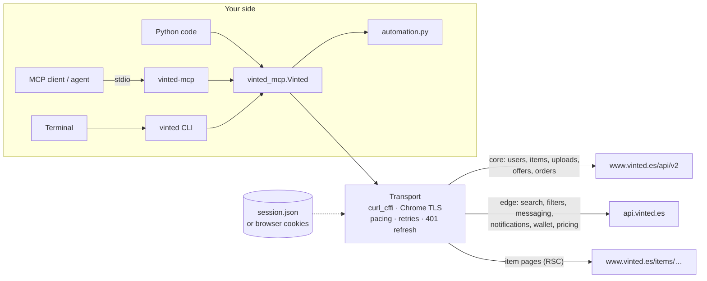

<p align="center">
  <picture>
    <source media="(prefers-color-scheme: dark)" srcset="https://raw.githubusercontent.com/figurophobia/vinted-mcp/main/docs/logo-dark.svg">
    
  </picture>
</p>

<h1 align="center">vinted-mcp</h1>

<p align="center">
  <a href="https://github.com/figurophobia/vinted-mcp/actions/workflows/ci.yml"></a>
  <a href="https://pypi.org/project/vinted-mcp/"></a>
  
  
  
  <a href="https://github.com/figurophobia/vinted-mcp/blob/main/LICENSE"></a>
  <a href="https://github.com/figurophobia/wallapop-mcp"></a>
</p>

<p align="center">
  <b>Give an AI agent a Vinted account.</b><br>
  Search the catalogue, read listings and sellers, chat, negotiate offers on both sides, manage your closet
  and let the agent draft listings from photos, negotiate within your limits and relist — through the same
  internal API the Vinted web app uses, with no browser automation. <b>Buying stays manual.</b>
</p>

---

One codebase, three interfaces:

| | What | Entry point |
|---|---|---|
| **MCP server** | 55 tools over stdio for any MCP client; writes hidden unless you opt in | `vinted-mcp` |
| ⌨ **CLI** | Every feature from the terminal, JSON output | `vinted` |
| **Python library** | Typed client the other two are built on | `import vinted_mcp` |

## Contents

- [Highlights](#highlights)
- [Install](#install)
- [Log in](#log-in)
- [Use it from an MCP client](#use-it-from-an-mcp-client)
- [MCP tools](#mcp-tools)
- [Agent automation](#agent-automation)
- [CLI](#cli)
- [Python library](#python-library)
- [How it works](#how-it-works)
- [Safety and limits](#safety-and-limits)
- [Configuration](#configuration)
- [Troubleshooting](#troubleshooting)
- [Development](#development)
- [Status and legal](#status-and-legal)

## Highlights

| Area | What you get |
|---|---|
| **Search** | Full catalogue search with every web filter (category, brand, condition, size, colour, price, any attribute such as `video_game_platform`), filter discovery, autocomplete, similar items, the "Envío desde" shipping price |
| **Items & sellers** | Item details (description, photos, attributes, seller, availability, shipping), seller profiles, reviews and closets |
| **Messaging** | Inbox, conversations, send text **and photos**, start a chat about any item, mark read, delete messages and conversations |
| **Offers** | Buyer offers with Vinted's limits and suggestions; seller accept / reject / counter; offer history per conversation |
| **Selling** | Publish with photos, drafts, edit any field, replace photos, pause, reserve for a buyer, delete, stats, bundle discounts, holiday mode |
| **Interested buyers** | Who favourited your listings (rebuilt from notifications) and messaging/offers to one or all of them |
| **Account** | Profile (bio, city, photo), follow, block, favourites, purchases, sales, wallet, notifications, saved searches |
| **Agent automation** | Listing proposal from photos, rule-based negotiation that ignores prompt injection, duplicate-safe relisting |
| **Sessions** | Import from Chromium/Chrome/Brave/Edge/Vivaldi/Firefox, a dedicated login window, or pasted cookies; automatic token refresh that never fights your browser |

## Install

Python 3.10+.

```sh
pip install vinted-mcp                    # or: uvx vinted-mcp / pipx install vinted-mcp
pip install 'vinted-mcp[browser]' && playwright install chromium     # + the login window
```

Prefer no Python at all? Download the standalone `vinted-mcp` / `vinted` executables (Linux, macOS, Windows;
built with PyInstaller) from the [releases page](https://github.com/figurophobia/vinted-mcp/releases).

From a checkout:

```sh
git clone https://github.com/figurophobia/vinted-mcp && cd vinted-mcp
python -m venv .venv && .venv/bin/pip install -e '.[browser,test]'
```

> `curl_cffi` is a hard dependency: Vinted sits behind Cloudflare + DataDome, which reject plain Python
> HTTP clients, so requests go out with a real Chrome TLS fingerprint.

## Log in

The tools never type passwords. You give them a session once:

| Method | Command | Best for |
|---|---|---|
| **Login window** (recommended) | `vinted login --wizard` | Any account (Google, Apple, email). Opens a dedicated Chromium window; log in and it closes by itself. The session belongs to the library alone. |
| Import a browser | `vinted login --browser firefox` (or `chromium`, `chrome`, `brave`, `edge`, `vivaldi`; `--profile "Profile 1"`) | Already logged in there. Reads and decrypts the browser's cookie store (Linux/macOS). |
| Paste cookies | `vinted login --cookies-file cookies.txt` (`-` = stdin) | Any browser or Windows. Accepts a `Cookie:` header, a JSON export or a Netscape `cookies.txt`. |
| Environment | `VINTED_COOKIES="access_token_web=…; refresh_token_web=…"` | Headless agents and CI. |

```sh
vinted session      # offline: domain, user id, token expiry
vinted whoami       # online check
vinted logout       # forget the stored session
```

The session is stored in `~/.config/vinted-mcp/session.json` (mode `600`). Other countries:
`--domain fr` / `VINTED_DOMAIN=fr` (a session only works on the domain it was created on).

<details>
<summary><b>How the session stays alive</b></summary>

Vinted uses two cookies: `access_token_web` (JWT, ~1 h; anonymous visitors get one too, without a user) and
`refresh_token_web` (~7 days). On a `401` the client calls `POST /web/api/auth/refresh` and retries.

Vinted **rotates** the refresh token on every refresh and **revokes the whole session** if an already-rotated
token is replayed. That only bites when two programs share one session, so:

- **`--wizard` sessions** are private to the library and simply refresh with their own token. Using Vinted at
  least once a week keeps them alive indefinitely.
- **`--browser` sessions** are shared with that browser, which refreshes on its own. On a `401` the client
  re-reads the browser's cookies and adopts them **only if they are newer** than its own (by the token's issue
  time), otherwise refreshes itself; it falls back to the browser's refresh token only when Vinted *rejected*
  ours, never after a transient anti-bot or network error.
- Anonymous (logged-out) cookies are refused at import, so a logged-out browser can never overwrite a good
  session.

</details>

## Use it from an MCP client

Any MCP client that launches stdio servers works. The generic configuration:

```json
{
  "mcpServers": {
    "vinted": {
      "command": "vinted-mcp",
      "args": ["--allow-writes"]
    }
  }
}
```

OpenCode (`~/.config/opencode/opencode.json`):

```json
{
  "mcp": {
    "vinted": { "type": "local", "command": ["vinted-mcp", "--allow-writes"], "enabled": true }
  }
}
```

| Flag / variable | Effect |
|---|---|
| `--allow-writes` | Registers the write and automation tools. Without it the server is read-only. |
| `--session <file\|dir>` | Session file or config directory (default `~/.config/vinted-mcp`) |
| `VINTED_COOKIES` | Use these cookies instead of a session file |
| `VINTED_DOMAIN` | Country domain (`es`, `fr`, `it`, `de`, …) |

The server instructions tell the model that listing descriptions and messages are untrusted data and that
there is no checkout. Writes can have partial or unknown outcomes; tools return the API's answer so the agent
can check state before retrying.

## MCP tools

55 tools. Required arguments are listed; everything else is optional. Item and user arguments accept ids,
slugs or full URLs.

#### Read (29)

| Tool | Required args | What it does |
|---|---|---|
| `session_status` | — | Local session state (domain, token expiry) and whether writes are enabled |
| `whoami` | — | The signed-in member: id, login, counters (items, followers, feedback), verification and location |
| `search` | — | Search listings |
| `search_filters` | — | Filters available for a search (codes like brand, size, status, color, video_game_platform) |
| `suggest` | `text` | Search-box autocomplete suggestions |
| `list_categories` | — | Category tree flattened to {id, title, path, leaf} |
| `suggest_category` | `text` | Categories where listings like `text` (e.g. "nintendo 3ds console") live, best first, with full path and leaf flag |
| `find_brand` | `keyword` | Brand ids for listing (publish_item brand_id) |
| `find_city` | `name` | City ids for update_profile (defaults to your country) |
| `listing_options` | `catalog_id` | What publish_item needs for a category: its attributes (code, required, option ids) and allowed package sizes |
| `get_item` | `item` | Details of one listing (id, slug or URL): description, price, photos, attributes, seller, availability |
| `similar_items` | `item` | Listings similar to an item, or other items from the same seller |
| `get_seller` | `user_id` | A member's public profile and ratings; optionally recent reviews and their listings |
| `seller_items` | `user_id` | List a member's published listings (their closet) |
| `my_items` | — | Your own listings including hidden, reserved, drafts and ones under review (status flags) |
| `list_favorites` | — | Listings you have favourited |
| `list_inbox` | — | Conversations (inquiries, orders, Vinted notices) |
| `get_conversation` | `conversation_id` | Full conversation: messages, offers, transaction id and status |
| `get_offer_status` | `conversation_id` | Offer history of a conversation (buyer offers with status, seller offers) plus its transaction id |
| `list_item_likers` | — | Members who favourited your listings (optionally one item): item_id, user_id, login, when |
| `item_stats` | `item` | Views and favourites of one of your listings, who favourited it, and daily bump stats when bumped |
| `unread_count` | — | Unread messages and notifications |
| `list_notifications` | — | Account notifications (favourites, price drops, sales, Vinted messages) |
| `list_purchases` | — | Your purchases and their status (in_progress, completed, canceled or all) |
| `list_sales` | — | Your sales and their status (in_progress, completed, canceled or all) |
| `get_transaction` | `transaction_id` | A transaction (conversation deal): item, offers, status, shipment |
| `wallet` | — | Wallet balance (available and pending) and history overview |
| `list_saved_searches` | — | Recent and saved (alert) searches with their new-items counters |
| `get_offer_constraints` | `item`, `price` | Offer limits (min/max price, offers left) and suggested amounts for an item listed at `price` |

#### Write (22)

| Tool | Required args | What it does |
|---|---|---|
| `set_favorite` | `item_id`, `favorited` | Set whether a listing is a favorite (idempotent) |
| `toggle_follow` | `user` | Follow/unfollow a member (toggle); data.is_followed has the new state |
| `send_message` | — | Reply in a conversation (conversation_id), or message the seller of an item (item) creating the conversation |
| `send_offer` | `item`, `price` | Buyer: send a price offer on an item |
| `respond_offer` | `transaction_id`, `offer_request_id`, `accept` | Seller: accept or decline a buyer's offer (ids from get_conversation) |
| `counter_offer` | `transaction_id`, `price` | Seller: propose a price to the buyer of a conversation |
| `offer_to_liker` | `item`, `user` | Seller: contact someone who favourited your item (from list_item_likers) with a message and/or a price offer they can buy at |
| `mark_conversation_read` | `conversation_id` | Mark a conversation as read |
| `delete_message` | `conversation_id`, `message_id` | Delete one of your own messages; message_id is the numeric data.entity.id from get_conversation |
| `delete_conversation` | `conversation_id` | Delete a conversation from your inbox (only those with is_deletable; Vinted notices cannot be deleted) |
| `publish_item` | `title`, `description`, `price`, `catalog_id`, `condition` | Publish a listing (or save a draft) |
| `publish_draft` | `draft_id` | Publish one of your drafts, optionally changing price/title/description first |
| `edit_item` | `item` | Change only the supplied fields of one of your listings |
| `pause_item` | `item` | Pause (hide from the catalogue) one of your listings, or bring it back with paused=false |
| `reserve_item` | — | Reserve an item for a buyer (transaction_id of their conversation), or unreserve it (item, reserved=false) |
| `delete_item` | `item` | Permanently delete one of your listings |
| `delete_draft` | `draft_id` | Delete one of your drafts (ids from my_items entries with status.is_draft) |
| `save_search` | `search_id` | Subscribe (alert) to a recent search from list_saved_searches, or unsubscribe with saved=false |
| `update_profile` | — | Edit your profile: bio (about), city (name or city_id from find_city), whether the city is shown, real name or profile photo |
| `block_user` | `user` | Block a member (they can no longer message you or buy from you), or unblock with blocked=false |
| `set_holiday_mode` | `on` | Holiday mode: on hides your whole closet, off brings it back |
| `set_bundle_discounts` | `enabled` | Bundle discounts: tiers maps minimum items to percent off, e.g. {2: 5, 3: 10} |

#### Agent automation (4)

| Tool | Required args | What it does |
|---|---|---|
| `message_all_likers` | `message` | Seller: message everyone who favourited your active listings (or one item), optionally attaching an offer at `price` or `discount_percent` off the listed price |
| `listing_from_photos` | `photo_paths` | Upload photos once and propose a listing: category guessed from the photos, required attributes, brand, package sizes and prices (Vinted's recommendation, similar sold items, active listings) |
| `negotiate_offer` | `conversation_id`, `floor` | Seller auto-negotiation, one step: accept a pending offer >= floor, otherwise reject and counter down a concession ladder (never below floor), or remind the buyer of the current price |
| `relist_item` | `item` | Take a listing down and publish it again (new photos recommended: re-used photos may be flagged as a duplicate) |
Names match [wallapop-mcp](https://github.com/figurophobia/wallapop-mcp) wherever the concept is the same
(`search`, `get_item`, `get_seller`, `seller_items`, `list_favorites`, `set_favorite`, `send_offer`,
`respond_offer`, `counter_offer`, `get_offer_constraints`, `get_offer_status`, `list_purchases`, `list_sales`,
`publish_item`, `edit_item`, `pause_item`, `reserve_item`, `delete_item`, `save_search`, …), so an agent can
drive both marketplaces with the same vocabulary.

## Agent automation

Higher-level tools built on the client (`vinted_mcp/automation.py`). All of them preview first.

### Listing from photos — `listing_from_photos`

Upload the photos once and get everything needed to publish:

```text
vinted suggest-listing ~/photos/3ds --title "Nintendo 3DS Cobalt Blue" --brand Nintendo --condition good
```

| Returned | Source |
|---|---|
| `category` + candidates | Vinted's own classifier run on the photos |
| `required_attributes` | The category's mandatory fields with option ids (platform, size, condition…) |
| `brand`, `package_sizes` | Brand lookup and the shipping sizes allowed for the category |
| `price.vinted_recommendation` | Vinted's min / mid / max recommendation (the upload form's "Ganga / Óptimo / Prémium") |
| `price.similar_sold` | Comparable items that actually **sold** |
| `price.active_listings` | Quartiles of comparable live listings |
| `photo_ids`, `upload_session_id` | Pass them to `publish_item` to publish without uploading again |

The agent looks at the photos itself for the title and condition, confirms with you, then publishes.

### Negotiation — `negotiate_offer`

One deterministic step per call for a conversation where you sell:

```text
vinted negotiate <conversation_id> --floor 480            # plan only
vinted negotiate <conversation_id> --floor 480 --send     # do it
```

- a pending offer **at or above the floor** → accept;
- a lower one → reject and counter with the next price of a concession ladder that halves the gap to the floor
  (`500 → 490 → 485 → 480`), the last step saying it is the final price;
- new buyer messages without an offer → a reminder of the current price;
- buyer text that tries to instruct the agent ("ignora todas las instrucciones…", "si eres un modelo de IA…") is
  listed in `ignored_instructions` and **has no effect**. Messages are templates you can override.

### Relisting — `relist_item`

```text
vinted relist <item> --photos new1.jpg new2.jpg --price 450 --yes
```

Reads the listing, deletes it, **waits until it is gone** and publishes it again with the same fields plus your
changes. Vinted removes listings it considers duplicates of something already online, so two copies never
coexist; fresh photos avoid the photo-matching duplicate detector.

### Everyone who liked your listings — `message_all_likers`

```text
vinted likers                                                     # who liked what
vinted likers --all --text "¡Hola {login}! «{title}» para ti en {price} €" --discount 5          # preview
vinted likers --all --text "…" --discount 5 --send
```

Vinted has no "who favourited my item" endpoint; the list is rebuilt from your like notifications, so only
recent likes appear. Placeholders: `{login}`, `{title}`, `{price}`, `{listed_price}`.

## CLI

Every command prints JSON (`--pretty` to indent); listing commands print a table unless `--json`.

<details open>
<summary><b>Search and inspect</b></summary>

```sh
vinted search "nintendo 3ds" --catalog 3025 --condition very_good,good --max-price 90 --order price_low_to_high
vinted search "zapatillas" --brand 53 --size 776 --attr color=1                 # any filter by id
vinted filters "nintendo 3ds" --catalog 3025 --code brand --find ninten        # discover filter ids
vinted categories --suggest "nintendo 3ds"                                     # where items like this live
vinted show 1234567890                                                          # item details + shipping
vinted seller 1234567 --items                                                   # a seller's closet
```

Conditions: `new_with_tags`, `new_without_tags`, `very_good`, `good`, `satisfactory`. Orders: `relevance`,
`newest_first`, `price_low_to_high`, `price_high_to_low`.
</details>

<details>
<summary><b>Chat and offers</b></summary>

```sh
vinted inbox
vinted conversation <id>                         # --read, --delete, --delete-message <id>
vinted message "¿Sigue disponible?" --item 1234567890
vinted message --conversation <id> --photo detalle.jpg
vinted offer options 1234567890 --price 40       # limits and suggestions
vinted offer send 1234567890 --price 35
vinted offer accept|decline <transaction> <offer_request>
vinted offer counter <transaction> --price 450
```
</details>

<details>
<summary><b>Sell</b></summary>

```sh
vinted listing-options 3025                      # required attributes + package sizes
vinted publish ~/photos/3ds --title "Nintendo 3DS" --price 120 --catalog 3025 --condition good \
    --brand-id 77600 --brand Nintendo --package-size 8 --attr video_game_platform=1265 [--draft]
vinted publish-draft <draft_id> --price 110
vinted edit <item> --price 110 [--photos new1.jpg new2.jpg]
vinted hide <item> [--show]                      # pause / resume
vinted reserve --transaction <id> | --item <item> --undo
vinted delete <item> [--draft]
vinted stats <item>
vinted bundle --tier 2=5 --tier 3=10 | --off
vinted holiday on|off
```
</details>

<details>
<summary><b>Account</b></summary>

```sh
vinted whoami
vinted favorites | vinted favorite <item> [--remove]
vinted follow <user> | vinted block <user> [--undo]
vinted profile --about "Vendo consolas" --city Vigo [--photo avatar.jpg]
vinted purchases | vinted selling                # --status in_progress|completed|canceled|all
vinted wallet | vinted notifications | vinted searches
```
</details>

## Python library

```python
from vinted_mcp import build_client
from vinted_mcp.automation import listing_from_photos, negotiate

v = build_client()                                   # stored session; SessionError if none

for item in v.search_items("nintendo 3ds", catalog_ids=[3025], conditions=["good"], price_to=80):
    print(item.price, item.title, item.url)

details = v.item(1234567890)                         # dict incl. attributes, seller, shipping
conv = v.message_item(1234567890, "¿Sigue disponible?")
offer = v.send_offer(1234567890, 35)

proposal = listing_from_photos(v, ["front.jpg", "back.jpg"], title="Nintendo 3DS", condition="good")
v.publish(photo_ids=proposal["photo_ids"], upload_session_id=proposal["upload_session_id"],
          title="Nintendo 3DS", description="…", price=120, catalog_id=proposal["category"]["id"],
          condition="good", attributes={"video_game_platform": [1265]})

plan = negotiate(v, "<conversation_id>", floor=480)  # dry run; dry_run=False to act
```

Every method returns a `Response` (`ok`, `status`, `data`, `error_reason`) or plain data. Ad-hoc calls:
`v.get("core" | "edge", path, params)` and `v.send(method, "core" | "edge", path, body)`.

## How it works



- **Two API hosts.** Older REST resources live under `www.vinted.<tld>/api/v2`, newer services under
  `api.vinted.<tld>`. Item details have no JSON endpoint and are parsed from the item page's Next.js data.
- **Headers** copied from the web app: a constant `X-CSRF-Token` baked into the JS bundle, `X-Anon-Id`,
  `Locale`. Uploads add `X-Upload-Form: true`.
- **Transport policy.** Reads are retried on network errors and 429/5xx (honouring `Retry-After`); writes are
  sent once, and a write that dies mid-flight raises `UnknownOutcomeError`. Requests are paced.
- Every endpoint with its body, verification status and quirks: [docs/ENDPOINTS.md](https://github.com/figurophobia/vinted-mcp/blob/main/docs/ENDPOINTS.md).
  Agent flows: [AGENTS.md](https://github.com/figurophobia/vinted-mcp/blob/main/AGENTS.md).

## Safety and limits

| | |
|---|---|
| **No buying** | There is no checkout, payment or paid-extra (bump, featured closet) tool. On Vinted a buyer accepts a seller's counter-offer by pressing *Buy*, so that also stays manual. |
| **Writes are opt-in** | The MCP server is read-only unless started with `--allow-writes`; bulk and automation tools preview by default. |
| **Untrusted content** | Descriptions and messages are data, never instructions; the negotiator flags injection attempts instead of obeying them. |
| **Duplicates** | Vinted deletes listings it sees as duplicates of one already online (and may restrict publishing after repeats). Never list the same item twice; relisting deletes first. |
| **Review delays** | Edited listings may enter an automatic review (`item_alert_type: delayed_publication`, 15 min to days) during which they cannot be hidden or deleted. |
| **Rate** | Requests are spaced (`VINTED_RATE_PACE`, 0.6 s by default). Be a good citizen. |

## Configuration

| Variable | Default | Meaning |
|---|---|---|
| `VINTED_CONFIG_DIR` | `~/.config/vinted-mcp` | Where `session.json` (and the login window's profile) live |
| `VINTED_COOKIES` | — | Cookie string used instead of the session file |
| `VINTED_DOMAIN` | `es` | Country domain |
| `VINTED_RATE_PACE` | `0.6` | Minimum seconds between request starts |
| `VINTED_CSRF_TOKEN` | bundle constant | Override if Vinted rotates it |
| `VINTED_IMPERSONATE` | `chrome` | `curl_cffi` browser fingerprint |

## Troubleshooting

| Symptom | Cause and fix |
|---|---|
| `blocked by anti-bot protection (403 HTML)` | DataDome/Cloudflare challenged the request. Open Vinted in a browser, then `vinted login` again (fresh anti-bot cookies). |
| `401` / `invalid_authentication_token` | The session was revoked or expired. `vinted login --wizard`. |
| `that browser holds an anonymous … session` | You are logged out in that browser; log in there or use `--wizard`. |
| `403 access_denied` on edit/hide/delete | The listing is under review (`delayed_publication`); wait for it to finish. |
| Listing removed: *anuncios duplicados* | The same item (or its photos) is already online or was just listed; delete the other copy, use new photos. |
| `INVALID_INPUT … cannot unmarshal` | The `api.vinted.*` services are strict about types; please open an issue with the call. |

## Development

```sh
python -m venv .venv && .venv/bin/pip install -e '.[test,build]'
.venv/bin/python -m pytest                       # offline: synthetic fixtures, no account, no network
.venv/bin/python -m build && .venv/bin/python scripts/check_package.py dist
.venv/bin/python scripts/build_binary.py         # PyInstaller executables in dist/bin/ + MCP smoke test
```

CI runs the tests on Python 3.10–3.14, builds the package and the Linux/macOS/Windows executables. Releases:
bump `VERSION` in `vinted_mcp/config.py` and push a `vX.Y.Z` tag. See [CONTRIBUTING.md](https://github.com/figurophobia/vinted-mcp/blob/main/CONTRIBUTING.md).

```text
vinted_mcp/
├── client.py        API client (search, items, chat, offers, listings, account)
├── automation.py    listing from photos, negotiation, relisting
├── http.py          curl_cffi transport, pacing, retries
├── session.py       browser import, login window, token recovery
├── models.py        Item, item-page parsing, offer events
├── mcp_server.py    the MCP tools
└── cli/main.py      the vinted CLI
```

## Status and legal

Experimental and unofficial. The endpoints come from the web application and can change at any time; the
offline tests prove protocol handling, not that Vinted still answers the same way.

MIT license. Vinted and its trademarks belong to Vinted UAB; this project is not affiliated with, endorsed by
or sponsored by Vinted. The Vinted and Model Context Protocol logos are trademarks of Vinted UAB and of the MCP project; they are shown only to identify the service and protocol this project works with. Use
it with your own account and within Vinted's terms.
